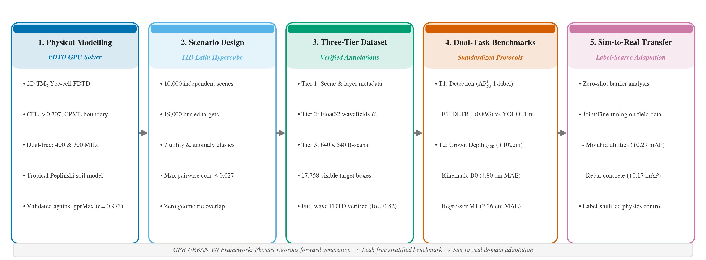
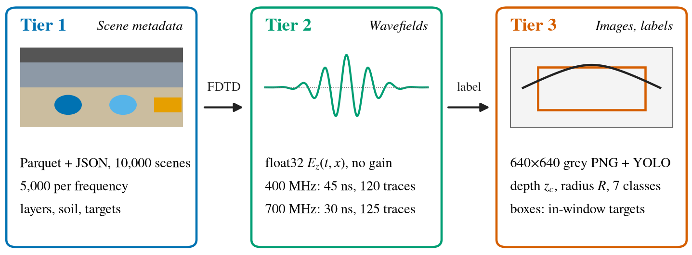
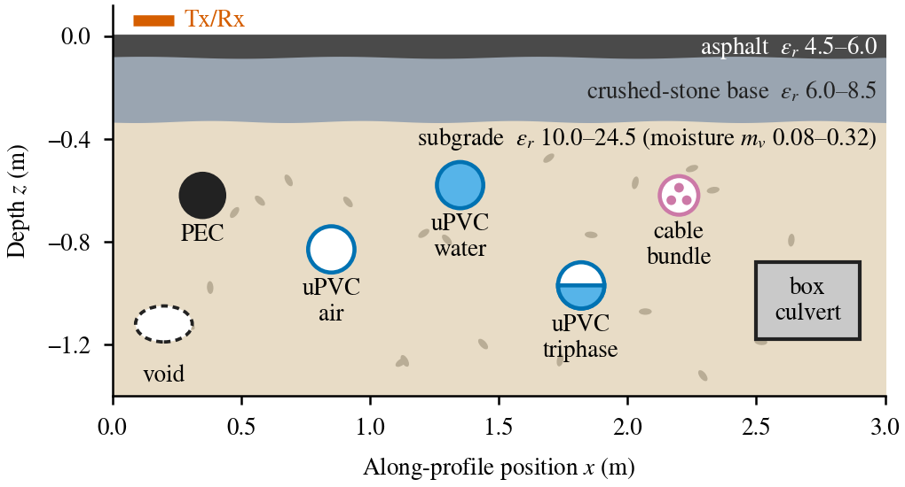
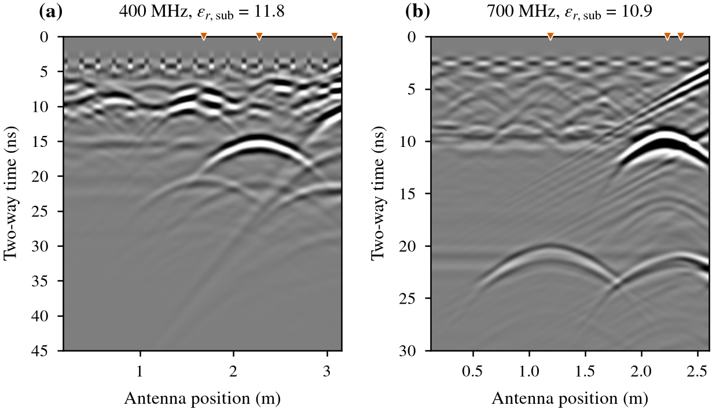
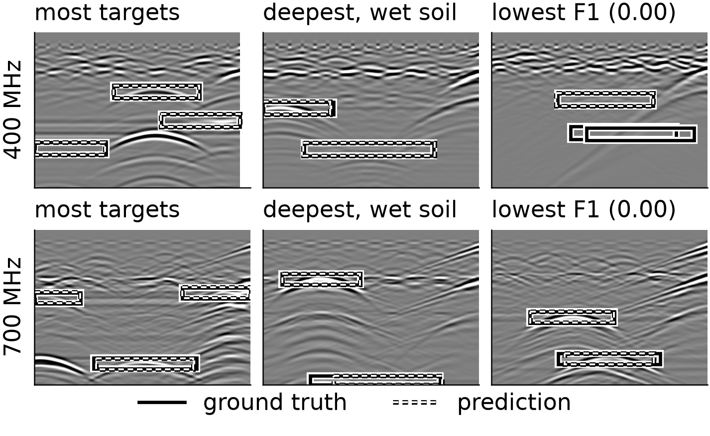
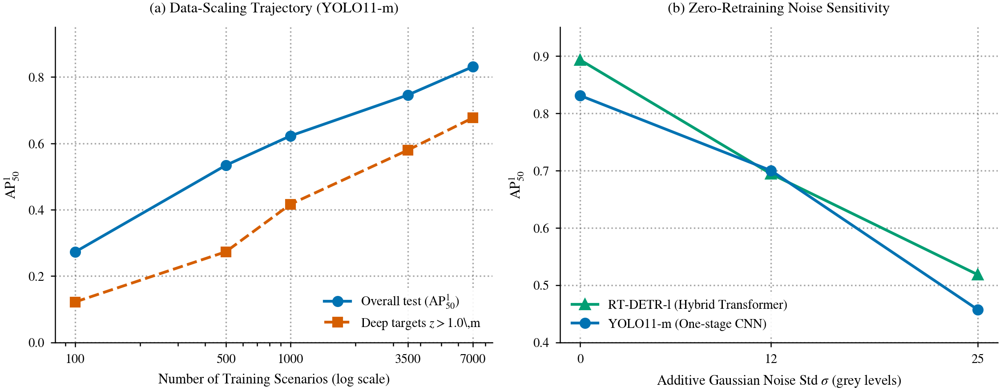
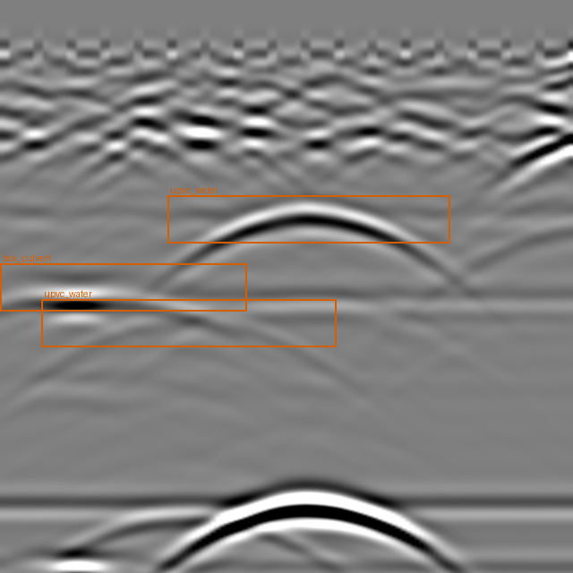

# GPR-URBAN-VN: A Physics-Validated Dual-Frequency Benchmark for Subsurface Detection and Depth Estimation in Tropical Urban Pavements

[](#citation)
[](LICENSE)
[](LICENSE-DATA.md)
[](https://www.python.org/)
[](https://pytorch.org/)
[](#full-dataset-access-harvard-dataverse-preview)

This repository contains the official benchmark code, data loaders, split manifests, verified geometry-based annotation generators, and evaluation scripts for **GPR-URBAN-VN**, submitted to **ACIIDS 2027 (Special Session on Computational Imaging and Vision - CIV)**.

---

## Overview and Methodology Pipeline

Ground penetrating radar (GPR) B-scans represent computational images of subsurface electromagnetic wavefields where buried utilities manifest as hyperbolic diffraction patterns. Developing learning-based interpretation for urban excavation safety requires open benchmarks combining instance-level annotations with verified physical geometry across variable moisture regimes.

**GPR-URBAN-VN** addresses this by introducing a physics-validated dual-frequency benchmark spanning 10,000 independent urban pavement scenarios (5,000 at 400 MHz and 5,000 at 700 MHz, unpaired) containing 19,000 buried targets across seven classes, structured into three tiers with 17,758 visible bounding boxes validated against FDTD background-subtraction scattered wavefields.

<p align="center">
  
</p>

### Key Contributions
1. **Large-Scale Multi-Tier Benchmark:** 10,000 scenarios, 19,000 targets across 7 classes, structured into Scene Metadata (Tier 1), Float32 Wavefields (Tier 2), and $640\times 640$ B-scans with 17,758 verified boxes (Tier 3).
2. **Physical Validation and Audit:** Custom GPU FDTD solver validated against gprMax ($r=0.973$, SSIM $0.995$, NRMSE $3.52\%$ on 20 pavement scenes); quasi-orthogonal 11D Latin Hypercube sampling (max pairwise correlation $\le 0.027$); zero overlapping geometry; and synthetic boxes confirmed against full-wave FDTD references (overall median IoU $0.76$, $0.82$ on cylindrical utilities, mean arrival time error $0.51$\,ns).
3. **Standardized Dual-Task Evaluation:** Leak-free scenario split grouped by exact geometry ($1\,\mu\text{m}$ tolerance). Reference detectors (YOLO11-m, RT-DETR-l) for detection (T1) and operational kinematic vs. learned regressor (M1 ResNet-18, MAE $2.26$\,cm) for depth estimation (T2).
4. **Transferability and Boundary Analyses:** Demonstrates that while zero-shot transfer collapses, simulation pre-training decisively accelerates field adaptation under label scarcity (+0.29 $\text{mAP}_{50}$ on Mojahid utilities with 8--20 radargrams; up to +0.172 on Rebar concrete), corroborated by label-shuffled physics controls.

---

## Dataset Architecture and Scene Stratigraphy

The dataset is structured into three distinct tiers to support both vision-based detection and wavefield inversion:

<p align="center">
  
</p>

* **Tier 1 (Metadata):** Layer thicknesses, permittivities, conductivities; target classes, lateral coordinate $x_c$, centre depth $z_c$, radius $R$, conduit fill level, and crown depth $z_{\mathrm{top}}$.
* **Tier 2 (Wavefields):** Received electric field $E_z(t, x)$ stored as uncompressed float32 arrays (120 traces over 45 ns at 400 MHz; 125 traces over 30 ns at 700 MHz).
* **Tier 3 (Images and Labels):** $640\times 640$ 8-bit radargrams paired with standard YOLO bounding boxes for all 17,758 visible targets with recorded echoes.

### Pavement Stratigraphy and Target Distribution

Each scene models a 3-layer flexible urban pavement: asphalt surface course ($h \in [0.06, 0.12]$\,m), crushed-stone base ($h \in [0.18, 0.32]$\,m), and tropical subgrade following the Peplinski dielectric model ($m_v \in [0.08, 0.32]$, $\varepsilon_{r,\mathrm{sub}} \in [10.0, 24.5]$, $\sigma_{\mathrm{sub}} \in [15, 85]$\,mS/m).

<p align="center">
  
</p>

| Class Name | Target Description | Overall Share | Test Boxes ($N$) | Depth Range ($z_c$) | Outer Size |
|---|---|---|---|---|---|
| `upvc_triphase` | Three-phase power duct (3 internal cables) | 31.14% | 1,096 | 0.25--1.40 m | $R \in [5, 15]$\,cm |
| `box_culvert` | Reinforced concrete drainage culvert | 27.41% | 1,014 | 0.40--1.40 m | $0.4\text{--}0.8 \times 0.4\text{--}0.6$\,m |
| `upvc_water` | Water pipe with water fill mixture | 15.68% | 565 | 0.25--1.40 m | $R \in [3, 20]$\,cm |
| `upvc_air` | Empty dry telecommunication conduit | 8.67% | 304 | 0.25--1.40 m | $R \in [3, 15]$\,cm |
| `pec` | Metallic utility conduit (perfect conductor) | 8.27% | 298 | 0.25--1.40 m | $R \in [2, 15]$\,cm |
| `cable_bundle` | Direct-buried power cable bundle | 8.05% | 281 | 0.25--1.40 m | $R \in [1.5, 5]$\,cm |
| `sinkhole_void` | Air/moisture-filled subsurface road void | 0.77% | 27 | 0.25--1.20 m | $R \in [5, 30]$\,cm |

### Dual-Frequency B-Scans and Visibility Horizon

Frequencies are assigned per scenario (5,000 at 400 MHz and 5,000 at 700 MHz, **unpaired**):

<p align="center">
  
</p>

**Visibility Horizon:** Due to dielectric attenuation and finite time windows (30 ns at 700 MHz reaches $\approx 1.0$\,m in wet soil vs. 45 ns at 400 MHz reaching $\approx 1.45$\,m), 1,242 of 19,000 targets produce echoes outside the recording window. The 700 MHz visible share drops from 96.2% in dry soil to 79.2% in wet soil. The test split contains 230 invisible targets among 3,815; detection benchmarks strictly evaluate on visible targets (17,758 total across the benchmark; 3,585 on the test split).

---

## In-Distribution Benchmark Results

### Task 1: Subsurface Utility Detection (T1)

Evaluated on 2,000 test B-scans (3,585 targets with bounding boxes). We report standard COCO metrics and **$\mathrm{AP}_{50}^{1}$** (greedy one-label-per-box matching at IoU=0.5, enforcing strict 1:1 attribution essential for civil mapping) with 95% percentile bootstrap confidence intervals over 1,000 test image resamples.

| Model | Architecture | Params | $\mathrm{mAP}_{50}$ | $\mathrm{mAP}_{50\text{--}95}$ | Precision | Recall | $\mathrm{AP}_{50}^{1}$ [95% CI] |
|---|---|---|---|---|---|---|---|
| **YOLO11-m** | One-stage CNN | 20.1M | 0.864 | 0.733 | 0.903 | 0.786 | 0.831 [0.802, 0.866] |
| **RT-DETR-l** | Hybrid Transformer | 32.8M | **0.893** | **0.845** | **0.922** | **0.837** | **0.893** [0.867, 0.918] |

#### Stratified Performance Analysis ($\mathrm{AP}_{50}^{1}$)

| Factor | Subset | Targets ($N$) | RT-DETR-l [95% CI] | YOLO11-m | Key Takeaway |
|---|---|---|---|---|---|
| **Frequency** | 400 MHz | 1,897 | 0.900 [0.861, 0.931] | 0.828 | In-distribution accuracy is balanced across frequencies |
| | 700 MHz | 1,688 | 0.896 [0.859, 0.932] | 0.848 | ($\Delta \le 0.02$, within bootstrap margins). |
| **Depth** | $z \le 0.6$\,m | 712 | 0.856 [0.802, 0.909] | 0.789 | Shallow: slight clutter from ground-bounce surface wave. |
| | $0.6 < z \le 1.0$\,m | 1,541 | 0.897 [0.856, 0.934] | 0.866 | Optimal detection window across both frequencies. |
| | $z > 1.0$\,m | 1,332 | **0.738** [0.694, 0.791] | 0.677 | **Governing factor:** Geometric spreading & attenuation. |
| **Moisture** | Dry ($\varepsilon_{r,\mathrm{sub}} < 14.8$) | 1,287 | 0.884 [0.848, 0.914] | 0.828 | Conditioned on visibility, soil moisture does not degrade |
| | Medium ($14.8 \le \varepsilon_r < 19.7$) | 1,145 | 0.902 [0.834, 0.954] | 0.848 | pattern recognition accuracy; moisture primarily |
| | Wet ($\varepsilon_{r,\mathrm{sub}} \ge 19.7$) | 1,153 | 0.905 [0.860, 0.948] | 0.825 | dictates the physical visibility window. |

#### Per-Class Detection Performance ($\mathrm{AP}_{50}^{1}$)
* `box_culvert` [1,014]: RT-DETR-l **0.981** / YOLO11-m 0.987
* `upvc_triphase` [1,096]: RT-DETR-l **0.945** / YOLO11-m 0.921
* `pec` (metallic) [298]: RT-DETR-l **0.927** / YOLO11-m 0.830
* `upvc_air` [304]: RT-DETR-l **0.921** / YOLO11-m 0.884
* `upvc_water` [565]: RT-DETR-l **0.915** / YOLO11-m 0.904
* `cable_bundle` [281]: RT-DETR-l **0.856** / YOLO11-m 0.777
* `sinkhole_void` [27]: RT-DETR-l **0.705** [0.52, 0.85] / YOLO11-m 0.513

<p align="center">
  
</p>

---

### Task 2: Crown Burial Depth Estimation (T2)

Predicting utility crown depth $z_{\mathrm{top}}$ (soil cover) within engineering safety tolerances ($\pm 5, \pm 10, \pm 20$\,cm). Over-estimation ($>10$\,cm deeper than truth) represents the primary excavation strike hazard.

* **B0 (Kinematic Baseline):** Converts travel time $t_{\mathrm{TWT}}$ from the box top edge via single linear calibration per frequency ($z = at + b$) fitted on training scenes (no soil permittivity metadata).
* **M1 (Learned Regressor):** ResNet-18 taking a $256\times 256$ crop centred on the box, predicting an additive residual correction to B0 (mean of 3 seeds).

| Stratum | Subset | Targets ($N$) | B0 MAE (cm) | B0 Over $>10$cm | M1 MAE (cm) | M1 Within $\pm 10$cm | M1 Over $>10$cm |
|---|---|---|---|---|---|---|---|
| **Overall** | All test targets | 3,585 | 4.80 | 4.5% | **2.26** $\pm$ .03 | **97.7%** | **0.8%** |
| **Moisture** | Dry ($\varepsilon_r < 14.8$) | 1,287 | 6.19 | 0.0% | **2.50** | 96.4% | 0.0% |
| | Medium | 1,145 | 2.44 | 0.2% | **2.09** | 98.7% | 0.6% |
| | Wet ($\varepsilon_r \ge 19.7$) | 1,153 | 5.59 | 13.7% | **2.17** | 98.1% | 1.9% |
| **Depth** | $z_{\mathrm{top}} \le 0.6$\,m | 1,287 | 2.39 | 0.0% | **0.92** | 100.0% | 0.0% |
| | $0.6 < z_{\mathrm{top}} \le 1.0$\,m | 1,547 | 5.26 | 6.8% | **2.37** | 98.9% | 0.9% |
| | $z_{\mathrm{top}} > 1.0$\,m | 751 | 7.99 | 7.3% | **4.34** | 91.5% | 1.8% |

> **Label Noise Floor:** On 143 targets with FDTD full-wave references, travel time uncertainty ($0.72$\,ns) maps to a physical depth uncertainty of **$2.08$\,cm**. M1 ($2.26$\,cm) approaches this intrinsic physical ceiling.

---

## Generalisation, Scaling, and Field Transfer

### 1. Out-of-Distribution (OOD) Generalisation

Models are trained on restricted sub-domains and evaluated on excluded partitions to test distribution shift robustness (YOLO11-m evaluated via $\mathrm{AP}_{50}^{1}$ with 95% bootstrap intervals, benchmarked against a control trained on 3,500 uniform scenes):

| Trained on | Tested on (targets $N$) | Held-out Model [95% CI] | Control Model [95% CI] | Shift Mechanism |
|---|---|---|---|---|
| **400 MHz only** (3,500 scenes) | 700 MHz (1,688) | 0.294 [0.271, 0.330] | 0.736 [0.703, 0.779] | **Dominant shift:** Cross-frequency loss of |
| **700 MHz only** (3,500 scenes) | 400 MHz (1,897) | 0.454 [0.436, 0.488] | 0.766 [0.718, 0.814] | $0.31$--$0.44$ $\mathrm{AP}_{50}^{1}$ without dual training. |
| **$\varepsilon_{r,\mathrm{sub}} < 19.7$** (4,724 scenes) | Wet tercile (1,153) | 0.687 [0.653, 0.750] | 0.742 [0.704, 0.802] | **Quasi-invariance:** Negligible wet loss. |
| **Shallow + Medium** (3,543 scenes) | Deep-tier scenes (1,869) | 0.617 [0.571, 0.664] | 0.715 [0.680, 0.757] | Depth extrapolation degradation. |
| **Shallow + Medium** (3,543 scenes) | Deep targets $z > 1.0$\,m (1,332) | 0.395 [0.358, 0.457] | 0.580 [0.546, 0.634] | Loss concentrated on targets deeper than 1\,m. |

### 2. Data Scaling and Noise Robustness

<p align="center">
  
</p>

* **Log-linear Scaling:** Performance scales steadily from 100 ($0.273$), 500 ($0.534$), 1,000 ($0.623$), and 3,500 ($0.746$) to 7,000 scenes ($0.831$) without plateauing. Deep targets ($z>1.0$\,m) gain the most ($0.122 \to 0.677$).
* **Noise Sensitivity:** While models are robust to zero-time shifts ($\pm 8$ pixels, $|\Delta \text{AP}| \le 0.010$) and background removal, additive Gaussian noise degrades performance sharply ($\sigma=12$: $-0.131$ / $-0.199$; $\sigma=25$: $-0.37$).

### 3. Sim-to-Real Transfer on Public Field Radargrams
Evaluated on **Mojahid** (utilities & voids, 131 original radargrams) and **Rebar** (concrete reinforcement, 1,371 scan-labelled images, split strictly by scan ID).

* **Zero-Shot Collapse:** Models applied directly to field data fail (Mojahid AUROC $0.23$--$0.37$, centre-in-box AP $0.06$--$0.15$; Rebar centre-in-box AP $0.08$--$0.12$, matching random centroids $0.09$--$0.13$).
* **Label-Scarce Adaptation:** When field labels are scarce, simulation pre-training decisively accelerates fine-tuning.
* **Label-Permutation Control (Shuf.):** Pre-training on simulated data with shuffled labels yields no benefit over COCO at 10% labels ($0.024$ vs. $0.035$ on Mojahid; $0.669$ vs. $0.656$ on Rebar), confirming that gains stem from physical wavefield representations. Correct labels win in 32 of 36 paired comparisons.

| Field Dataset | Labels (%) | COCO Init | Shuffled Sim Init | Sim Init (Ours) | Joint Sim+Field (Ours) |
|---|---|---|---|---|---|
| **Mojahid** (Utilities) | 10% (8 scans) | 0.035 | 0.024 | 0.133 | **0.328** $\pm$ .093 (+0.29 over COCO) |
| | 25% (20 scans) | 0.199 | 0.265 | 0.394 | **0.492** $\pm$ .038 (+0.29 over COCO) |
| | 100% (79 scans) | **0.697** $\pm$ .072 | 0.567 | 0.637 | 0.673 |
| **Rebar** (Concrete) | 10% (51--66) | 0.656 | 0.669 | **0.828** $\pm$ .010 (+0.172 over COCO) | --- |
| | 25% (127--164) | 0.852 | 0.872 | **0.880** $\pm$ .035 (+0.028 over COCO) | --- |
| | 100% (508--655) | 0.907 | 0.904 | **0.932** $\pm$ .014 (+0.025 over COCO) | --- |

---

## Quickstart and Usage

### 1. Installation
Clone the repository and install the lightweight requirements:
```bash
git clone https://github.com/BonTapHoa/gpr-urban-vn-benchmark.git
cd gpr-urban-vn-benchmark
pip install -r requirements.txt
```

### 2. Verify Split and Load Sample Data
Run the test suite to verify leak-free split disjointness and test sample integrity:
```bash
pytest
```

### 3. Quick Sample Visualisation
To inspect sample B-scans with bounding boxes:
```python
from gpr_urban_vn_benchmark import load_split, iter_split
from pathlib import Path

split = load_split("configs/splits/gpr_urban_vn_split_10k_base.json")
for sample_id, image, boxes in iter_split(split, "test", Path("sample_data")):
    print(f"Sample: {sample_id}, Image shape: {image.shape}, Targets: {len(boxes)}")
```
Or run the provided quickstart script or interactive Jupyter Notebook:
```bash
python examples/quickstart_visualize.py
# Or launch the comprehensive tutorial notebook:
jupyter notebook examples/quickstart_demo.ipynb
```

<p align="center">
  
  <br/><em>Example output from <code>sample_data/</code> with verified bounding boxes overlaid.</em>
</p>

---

## Technical Appendix and Supplementary Material

For detailed physical derivations, $7\times 7$ normalized detector confusion matrices, moisture-stratified depth distributions, and FDTD background-subtraction wavefield galleries, please refer to the technical appendix:
* **[Supplementary_Material.pdf](docs/Supplementary_Material.pdf)** (7-page comprehensive technical report)

---

## Full Dataset Access (Harvard Dataverse Preview)

The full 10,000-scenario multi-tier dataset (metadata, float32 wavefields, full $640\times 640$ image archives) is archived on **Harvard Dataverse**:
* **Permanent DOI:** `10.7910/DVN/VYMICL` (reserved; resolves upon acceptance)
* **Private Preview for Reviewers:** [Access Dataverse DRAFT Preview](https://dataverse.harvard.edu/previewurl.xhtml?token=c1a3328c-e06e-49b9-8351-52f6b7ce86ac)

---

## Repository Structure

```
gpr-urban-vn-benchmark/
├── assets/                  # Visualizations, diagrams, and plots for README
├── configs/
│   ├── splits/              # Official leak-free geometry-grouped scenario splits
│   └── dataset_physics_v2.json  # Grid discretizations and antenna parameters
├── docs/                    # Technical appendix (Supplementary_Material.pdf)
├── examples/                # Quickstart scripts and Jupyter tutorial (quickstart_demo.ipynb)
├── experiments/             # Cloud VM scripts for T1, T2, and transfer studies
├── gpr_urban_vn_benchmark/  # Benchmark Python package and data loader
├── sample_data/             # 12 representative test B-scans and box annotations
├── scripts/                 # Detection training and bootstrap evaluation scripts
├── src/
│   ├── fdtd_fused.py        # Custom PyTorch GPU 2D FDTD solver
│   ├── gpr_urban_generator.py   # Pavement and target geometry generator
│   └── label_refraction.py  # Geometry-based analytic box and depth labelling
└── tests/                   # Pytest test suite
```

---

## Citation and Authors

If you use GPR-URBAN-VN in your research, please cite:

```bibtex
@inproceedings{tu2027gprurbanvn,
  author    = {Tu, Dinh-Nguyen and Nguyen, Hoang-Thien-Nga and Dang, Hoai-Trung},
  title     = {{GPR-URBAN-VN: A Physics-Validated Dual-Frequency Benchmark for Subsurface Detection and Depth Estimation in Tropical Urban Pavements}},
  booktitle = {Proceedings of the Asian Conference on Intelligent Information and Database Systems (ACIIDS 2027)},
  series    = {Lecture Notes in Artificial Intelligence},
  publisher = {Springer},
  year      = {2027},
  note      = {Under review}
}
```

Authors:
* **Dinh-Nguyen Tu** (VNU University of Engineering and Technology, Hanoi) - Corresponding author (`tudn@vnu.edu.vn`)
* **Hoang-Thien-Nga Nguyen** (Le Quy Don High School for the Gifted, Danang)
* **Hoai-Trung Dang** (Danang University of Science and Technology, Danang)

---

## Licence

* Source Code: [MIT License](LICENSE)
* Benchmark Data & Annotations: [CC BY 4.0](LICENSE-DATA.md)
